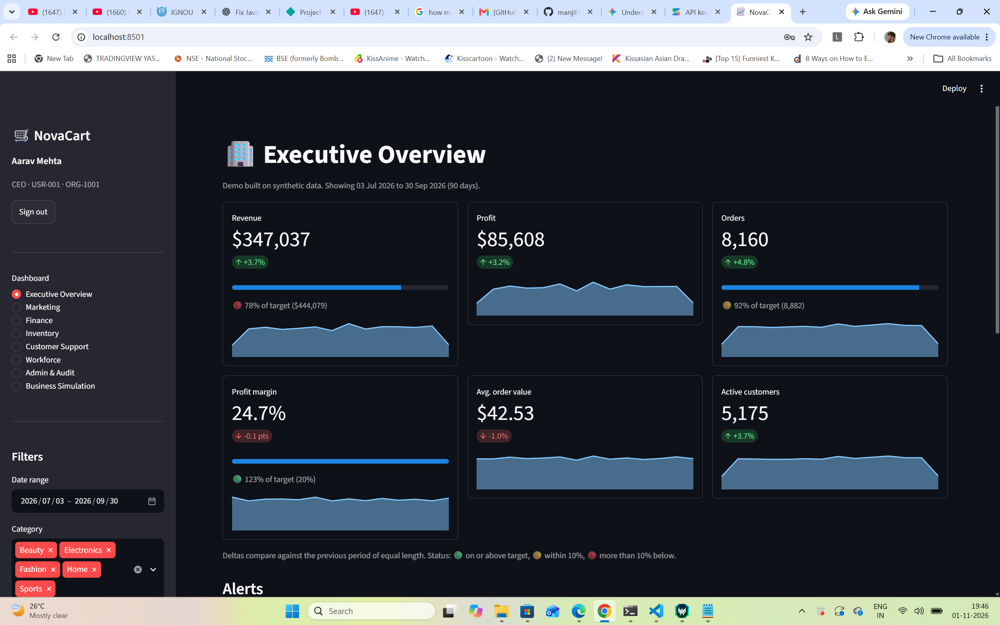
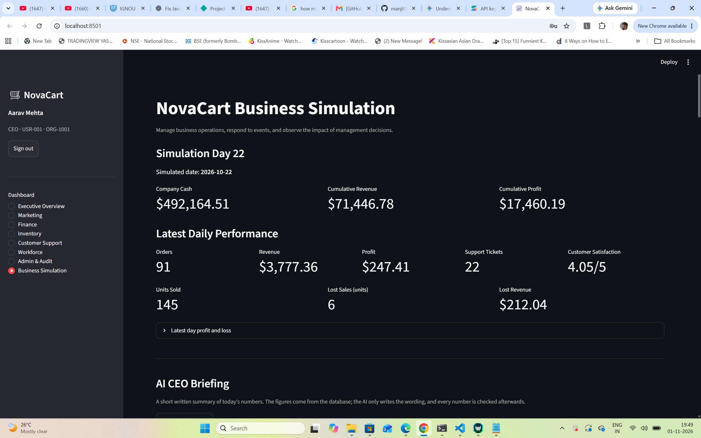
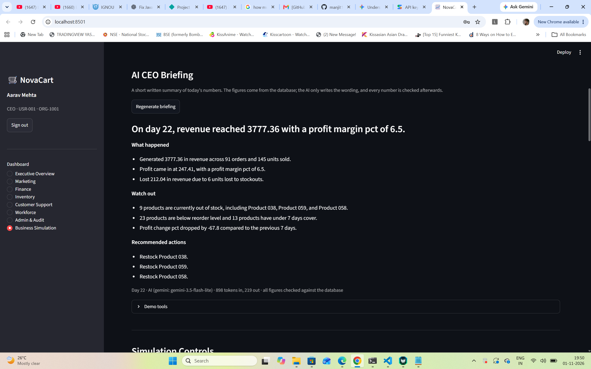

# NovaCart: KPI Dashboards and a Business Simulation

**Live demo: **https://novacart-demo.streamlit.app/
Log in as `ceo@novacart.example` / `Demo@CEO2026` (all demo data is synthetic).

A Streamlit app for a fictional e-commerce company. It has two parts:

1. **Role-based KPI dashboards** for the CEO, Marketing, Finance, Inventory and Customer Support, plus workforce and team views.
2. **A business simulation** where the CEO advances the company one day at a time and managers make real decisions (restocking, ad spend, support staffing). Sales, costs, stock and cash change as a result.

On top of that, the CEO gets an **AI daily briefing**: a short written summary of the day's numbers, with every figure checked against the database.

All data is synthetic. No real customers or companies are involved.



## Features

**Dashboards**
- Executive overview with KPI cards, targets, alerts and drill-downs
- Marketing, Finance, Inventory and Customer Support dashboards
- Workforce and team views built on a 200-person company database
- Sign-in with role-based access: each role sees only its own dashboards
- Audit log of sign-ins and dashboard opens (CEO)

**Business simulation**
- Advance the company one day at a time (CEO)
- Daily sales are built from product demand and available stock; out-of-stock products create *lost sales*
- Itemised daily costs: cost of goods, shipping, payment fees, returns, advertising, payroll, rent and hosting, plus interest on negative cash
- Procurement workflow: restock orders use cash, add stock and close the matching task
- Department tasks and a decision history, with permissions per role
- Reset the simulation to Day 0 (CEO, with an automatic database backup)



**AI CEO briefing**
- Plain Python collects the facts: revenue and profit against the previous 7 days, cash, stock-outs, the products that will run out soonest, open critical tasks
- An AI model (Google Gemini by default) turns those facts into a short briefing
- Every number in the text is then checked against the facts. Anything that cannot be matched is flagged on the page
- No API key, or the AI service fails: a rule-based briefing in the same layout is shown instead, so the page never breaks
- Each day's briefing is saved, so it is generated once per day unless you press Regenerate



## Quick start

Requires Python 3.12 or newer and [uv](https://docs.astral.sh/uv/).

```bash
git clone https://github.com/manjit10010-creator/novacart.git
cd novacart
git checkout v2-simulation

uv sync
uv run python setup_demo.py      # generates the data, accounts and database (takes seconds)
uv run streamlit run app.py
```

`setup_demo.py` refuses to overwrite existing data. Use `--force` to rebuild from scratch; your old files are moved into a `demo_backup_...` folder, not deleted.

### Demo accounts

| Role | Email | Password |
|---|---|---|
| CEO | ceo@novacart.example | Demo@CEO2026 |
| Marketing Manager | marketing@novacart.example | Demo@Mkt2026 |
| Finance Manager | finance@novacart.example | Demo@Fin2026 |
| Inventory Manager | inventory@novacart.example | Demo@Inv2026 |
| Customer Support Manager | support@novacart.example | Demo@Sup2026 |

These are demo logins for synthetic data only.

### Turning on the AI briefing (optional)

Without a key the app shows the free rule-based briefing. To use Gemini:

1. Create a free key in [Google AI Studio](https://aistudio.google.com/).
2. Create `.streamlit/secrets.toml` (it is git-ignored) containing:

   ```toml
   GEMINI_API_KEY = "your-key"
   ```

3. Sign in as the CEO, open **Business Simulation** and press **Generate today's briefing**.

Optional settings (environment variables): `NOVACART_AI_PROVIDER` (`gemini` or `anthropic`) and `NOVACART_AI_MODEL`. Anthropic is also supported if `ANTHROPIC_API_KEY` is set and the `anthropic` package is installed.

Free-tier AI services may use submitted content to improve their products. Use only synthetic data with a free key.

## How a simulated day works

1. Demand per product is its recent daily sales, adjusted by a random factor and the advertising level.
2. Units sold are limited by stock; the shortfall becomes lost sales.
3. Revenue and cost of goods come from units sold at each product's price and unit cost.
4. Itemised costs are charged, and profit is calculated.
5. Cash changes by revenue minus all costs except cost of goods (stock is paid for when it is bought).
6. Customer satisfaction, support tickets and low-stock tasks are updated.

The rules and constants live in `sim_engine.py`, which does not import Streamlit, so the whole engine can be tested without the UI.

## Project layout

| Path | Purpose |
|---|---|
| `app.py`, `auth.py`, `common.py`, `data_access.py` | App shell, sign-in, shared helpers |
| `views/` | One file per dashboard, plus the simulation page, AI briefing panel and demo tools |
| `sim_engine.py` | Simulation engine: all rules and database writes |
| `ai_briefing.py` | AI briefing: facts, AI call, figure check, saved briefings |
| `demo_tools.py` | Simulation reset with backup |
| `setup_demo.py` | One-command data and database setup |
| `generate_*.py`, `create_users.py`, `build_company.py` | Synthetic data and demo accounts |
| `test_*.py` | Tests (see below) |

## Tests

The tests work on temporary copies of the database and never change your data. The AI tests use a stand-in model, so they are free and work offline.

```bash
uv run python test_procurement.py      # restock workflow
uv run python test_stock_sales.py      # sales use up stock
uv run python test_sales_engine.py     # sales, cost of goods, lost sales
uv run python test_cost.py             # daily costs, payroll, overdraft
uv run python test_ai_briefing.py      # AI briefing and figure check
uv run python test_demo_tools.py       # setup safety and reset
```

The Streamlit pages themselves are not covered by automated tests.

## Known limitations

- Customer satisfaction reacts only weakly to support staffing and does not yet affect sales or returns.
- The Executive Overview page still reads the static historical data, not the live simulation.
- Restock orders arrive instantly (no supplier delays yet).
- Opening inventory is free, so not restocking looks good in the short term until stock runs out.

## Built with

Python, Streamlit, pandas, NumPy, Plotly, SQLite, Faker, and the Google Gemini API.
